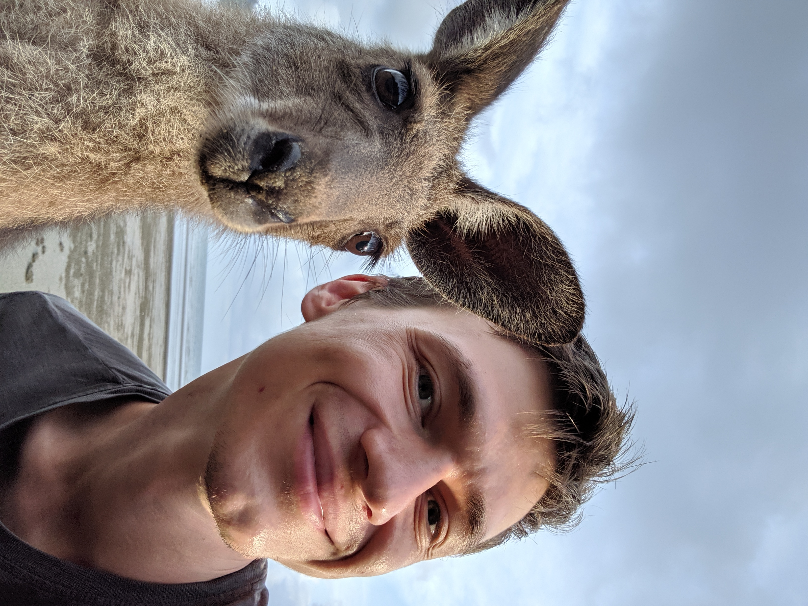
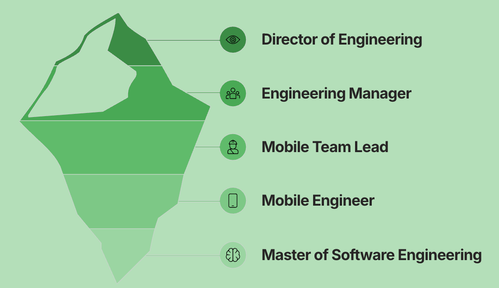
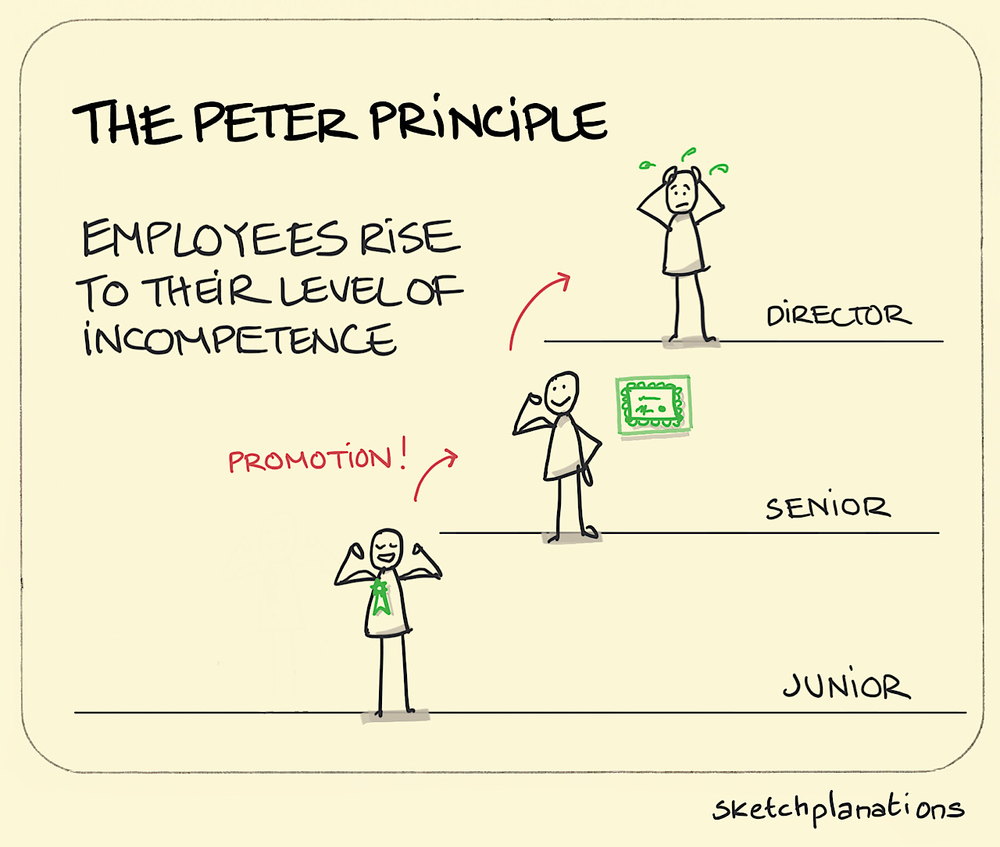
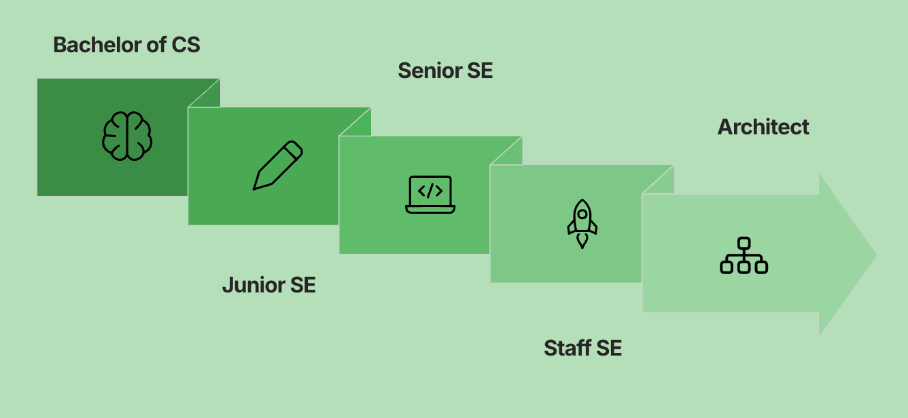
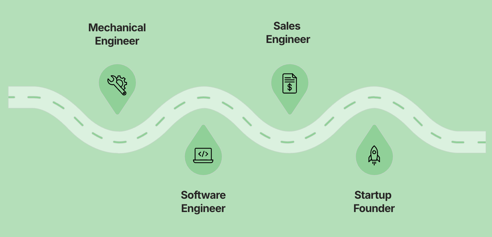
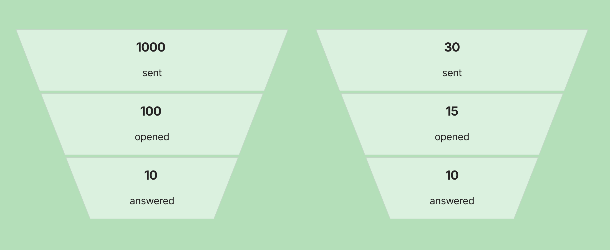
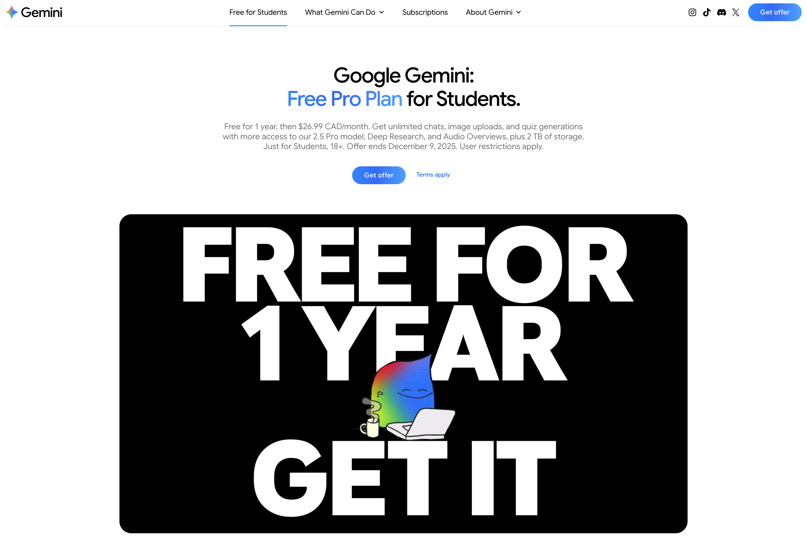
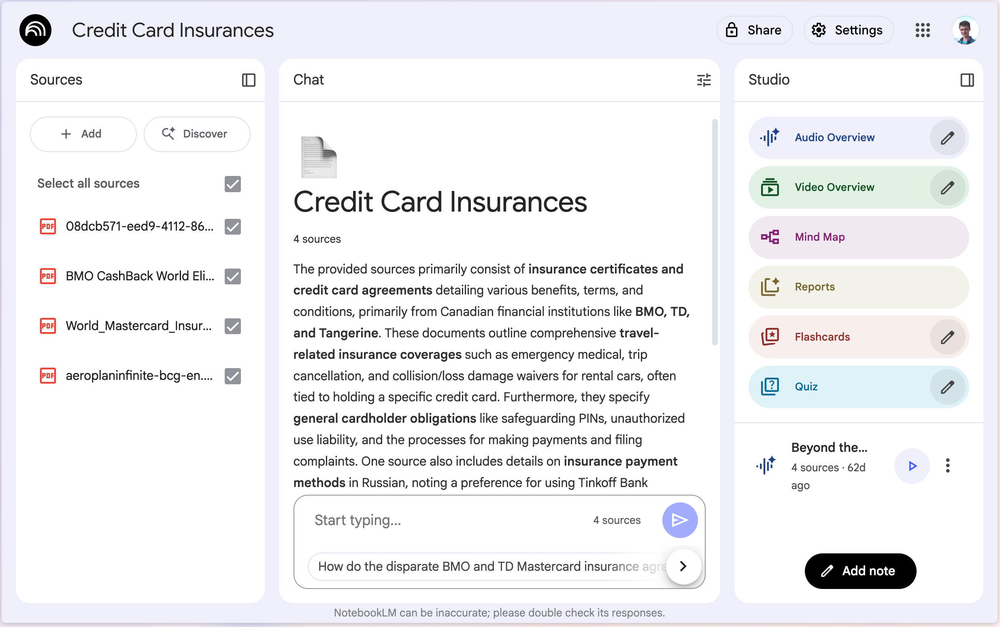
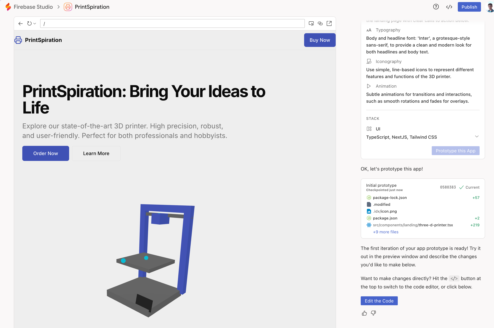

build-lists: true
slidenumbers: true
slidecount: true
slide-transition: true
autoscale: true

# Careers in Motion: What's your future?
### Artur Kuzmin

---

# Intro

^ Gemini saying: Hi! The future is coming. And your career might evolve faster than anything the last decade has seen.
Tomorrow, every engineer will have an invisible partner. A co-pilot that doesn’t replace your role, but expands it.
The real question isn’t whether AI will shape the future — it’s how you will shape it with AI.

---

# Three key points to remember

1. Career is not always linear
1. Be memorable
1. Use AI

---

# Artur Kuzmin

Head of AI at Squire,
Co-founder of Talent Agent

[linkedin.com/in/arturkuzmin/](linkedin.com/in/arturkuzmin/)
[twitter.com/ArtursTwit](twitter.com/ArtursTwit)

^ As a manager, I saw again and again that my Engineers thought that their next carer step must be to manage people. And that's the only way for a career progression. But

---

# Career is not always linear

^ Early-stage chaos is normal. You don’t need the perfect plan to start moving. You need to start.

---

# Vertical, Linear Career

^ It was a natural path to me: I enjoy working with people, growing people and improcing processes. It’s true that a ladder will help you ascend to new heights rather rapidly, but it’s also an extremely limiting path to take. You’ll have a relatively narrow perspective on the company and its business. You also run the risk of hitting an upward limit on your mobility — particularly if you happen to work for a company where employees tend to stick around for a long while.

---

^ I hope I'm not yet there, but who knows?

---

# Horizontal growth

^ And if you look at Levels.fyi, you'll see that Staff Engineers often earn more than different levels of managers

---

# Careers might be pretty different

^ Robin began his career as a mechanical engineer designing heavy mining equipment. Day-to-day, it was precise, structured work — but also repetitive. Over time, he got curious about the software tools the company used to monitor machine performance. He taught himself programming and slowly shifted into software engineering.
That opened new doors. Robin moved again — this time into sales engineering, where his mix of mechanical expertise and technical depth made him a translator between engineering teams and clients. Eventually, with experience across hardware, software, and business, he started building his own startup in stealth.
Robin’s path wasn’t random — each step stacked on top of the previous one, creating leverage he never had at the start.

---

# So what?

1.	Climbing the ladder isn’t the only growth path.
2.	Lateral moves can accelerate learning and earning.
3.	Each transition compounds your value.
1.  At some moment - evaluate it.

---

# Three key points

1. Career is not always linear
1. Be memorable
1. Use AI

---

# Opening the first door

^ It's interesting. Lots of candidates are looking for a job, lots of companies are looking for employees, and both parties keep rejecting each other. Hiring is very subjective.

---

# Be memorable

---

# Spray and pray vs Targeted outreach

 

^ The job market is tough. You can send three hundred resumes and get close to zero responses. You know what? I heard the same stories ten years ago. It might work. I consulted a person who wrote a script sending a thousand resumes

---

# It's all about conversion

^ Image - 1000 resumes, 0.1% of conversion = 10 interviews. 30 outreach messages, 33% conversion - 10 interviews.

---

# How to increase the conversion?

1. Talk about them, not you.
1. Perfect your Twit-length intro.
1. Multi-channel outreach and relationship.

---

# Talk about them, not you.

1. Hi! I'm Alex. I'm a graduate student and I'm looking forward to learn from you.
1. Hi! I'm Alex. I saw your "Adventurer" 3d printer became 10% more precise, that's cool! I decreased printing waste by 15% in my Final Project and I believe the same approach can be applied to "Adventurer".

^ People respond better when the conversation is about them, not you.
What do you think would a response be?
- Great!
- Really? Tell me more!

---

# Perfect your Twit-length intro

1. “I help [target] achieve [benefit].”
1. “I help [target] achieve [benefit] without [pain].”
1. "I’m Alex. I build fast prototypes that make manufacturing lines smoother."
1. “I'm Robin. I build tiny robots that move like animals to explore places humans can’t.”

^ When meeting someone new — recruiter, engineer, professor — you don’t have to recite your CV. You need to make them **curious** in 20 words.

---

# Multi-channel outreach

1. Don't just send a resume
1. Find the decision makers
1. Research info about the company and the role
1. Send email(s)
1. Connect on LinkedIn
1. Follow on Twitter
1. Don't become a stalker 😅

---

# Three key points

1. Career is not always linear
1. Be memorable
1. Use AI

---

# Use AI

^ Who's using AI daily?
I won't give all these standard speaches about how quickly it evolves and how useful it is. But I would really-really advise you spending at least a couple hours a week advancing your knoledge about it, because this can become your competitive edge.

---

# Gemini

1. Study mode
1. Quick chats
1. Company info collection

---

# Example: Company research

Provide a focused overview covering:
Company Mission & Core Problem:
- What problem does this company solve and for whom?
- What is their main mission or value proposition?
Recent Developments & News:
- Any significant recent news, pivots, funding, product launches, or strategic changes in the last 12-18 months?
Outreach Essentials:
- Key Terminology: What specific phrases, buzzwords, or language do they use to describe themselves?
...

---

---

---

# NotebookLM

1. Upload your resume
1. Record your answers to typical recruiter questions
1. Use Gemini to get company overview and some details regarding your area
1. Use Notebook LM to prepare talking points

---

# Firebase Studio

^ Old-school folks may not know about it, and you can stand out

---

# AI for Job Search
## Talent Agent 🎁
## Free 7-day resume building bootcamp.

#### https://a.gettalentagent.com/bootcamp/ar

---

# Three key points

1. Career is not always linear
1. Be memorable
1. Use AI

---

# What's next?

1. Just start!
1. Be curious!
1. Be reliable!
1. Enjoy the ride!

---

# Artur Kuzmin

Head of AI at Squire,
Co-founder of Talent Agent

[linkedin.com/in/arturkuzmin/](linkedin.com/in/arturkuzmin/)
[twitter.com/ArtursTwit](twitter.com/ArtursTwit)

Bonus:

